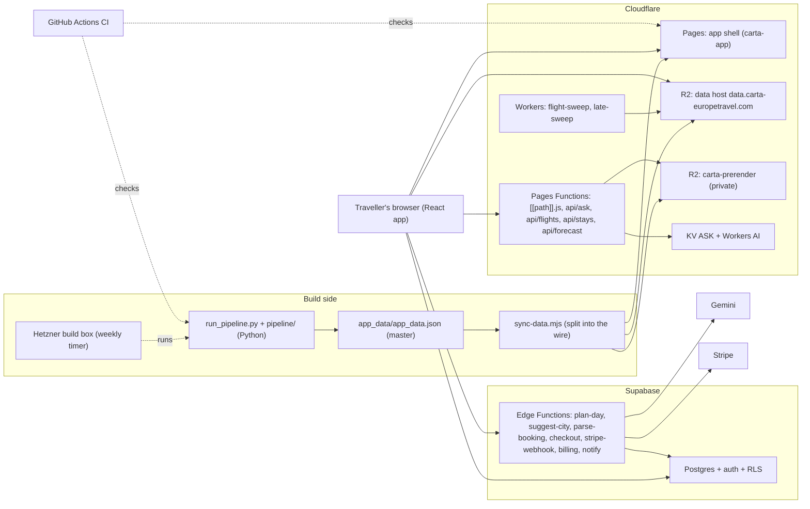

# Architecture overview

How Carta's parts fit together. Built by T1073 (ROADMAP B2) from `continent-app/wrangler.toml`, `continent-app/scripts/build-pages.mjs`, `continent-app/src/lib/dataHost.js`, `supabase/functions/`, `infra/hetzner/README.md`, `.github/workflows/` and the handbook sections "The data wire", "Deploy", "The build box" and "CI and checks". Diagrams per request path and per pipeline task come with ROADMAP B5; ADRs go in this folder when decisions are recorded.

## The picture

## The parts

| Part | What it does | Where it lives |
|---|---|---|
| Pipeline | Python tasks turn harvested sources into one master dataset (`app_data/app_data.json`) and layer folders. Entry point `python run_pipeline.py <task>`. | `run_pipeline.py`, `pipeline/`, `src/ingestion/`, `src/estimation/` |
| Wire build | `sync-data.mjs` splits the master into a boot index, one shard per country and detail files; `check-contract.mjs` checks the shape against `docs/SCHEMA.md`. | `continent-app/scripts/sync-data.mjs`, `continent-app/scripts/ci/` |
| App shell | A Vite and React single page app served by Cloudflare Pages (project `carta-app`). It talks to Supabase and the data host straight from the browser. | `continent-app/src/`, `continent-app/wrangler.toml` |
| Pages Functions | One catch-all Function serves about 32,000 prerendered pages from a private R2 bucket (only paths in `public/_routes.json` reach it); `api/` Functions serve Ask answers (Workers AI, KV counter), live flights, live stays and the forecast. | `continent-app/functions/` |
| R2 data host | Public read bucket behind `data.carta-europetravel.com`; the `R2_TIER` list in `src/lib/dataHost.js` says which folders live there. Images are on `cdn.carta-europetravel.com` (per the handbook and the archived incident runbook; not re-verified here). | `continent-app/scripts/r2/`, `continent-app/src/lib/dataHost.js` |
| Workers | `flight-sweep` (Cloudflare Worker with its own `wrangler.toml` and `schema.sql`) and the `late-sweep` script run by a systemd unit on the box. | `continent-app/workers/` |
| Supabase | Postgres with row level security, auth, and Edge Functions. Edge Functions: `plan-day`, `suggest-city`, `parse-booking` (Gemini), `checkout`, `stripe-webhook`, `billing`, `notify`. Migrations are in `supabase/migrations/`. | `supabase/` |
| Gemini | The model behind the three AI Edge Functions, under per-user and global daily caps. Never the Claude API (CLAUDE.md). | `supabase/functions/plan-day/`, `suggest-city/`, `parse-booking/` |
| Stripe | Pass checkout and webhook. Test mode until the owner steps in `Execution/P2/_OPEN-stripe-launch.md`. | `supabase/functions/checkout/`, `stripe-webhook/` |
| Hetzner build box | An always-on small server (CAX11, or CX23 when ARM is out of stock) runs the weekly pipeline from a systemd timer and pushes data to R2; a larger CAX41 exists only for heavy jobs. | `infra/hetzner/` |
| CI | 13 GitHub workflows (`ci.yml` plus path-triggered checks and `uptime.yml`, a 15 minute monitor). | `.github/workflows/` |

## Request paths in one line each

- Browse: browser, Pages (shell), then the boot index and country shards from the R2 data host; a crawler's request for a place path goes through the catch-all Function to the prerender bucket.
- Ask: browser, `api/ask` Functions (retrieval and a Workers AI answer behind the KV Neurons counter).
- Plan with AI: browser, Supabase Edge Function (`plan-day`), Gemini; pass and cap checks use the Supabase database.
- Pay: browser, Stripe Checkout through the `checkout` Edge Function; `stripe-webhook` grants the pass.
- Data refresh: the box (or a laptop run) runs the pipeline, builds the wire and pushes it to R2 in two phases (copy, then prune after production is live).

## Not verified here

Whether the Hetzner boxes run in production today: the handbook describes the schedule and `infra/hetzner/README.md` says both boxes existed "as code" when it was written; the register (`Execution/P3/_OPEN-hetzner.md`) holds the owner steps. DNS and Cloudflare dashboard settings are not in git.

See also: [../runbooks/README.md](../runbooks/README.md), [../data/README.md](../data/README.md), [../security/](../security/) (threat model, Track C), [../HANDBOOK.md](../HANDBOOK.md).
