# Data lineage

Generated by `python -I scripts/docs/build_lineage.py` (T1166, ROADMAP B5). Do not edit by hand:
change `docs/architecture/lineage-fields.json` (source, task, artifact, writer) and rerun.
Wire files come from `continent-app/src/lib/bootIndex.js`; app readers are found by a pattern
search of `continent-app/src` for `dest.field`, `d?.field`, `meta.field` and similar, so a reader
that destructures a record is missed. Request paths are in [request-paths.md](request-paths.md).

## Counts

| What | Count |
|---|---|
| Wire fields in `docs/wire.schema.json` | 77 |
| ...with a lineage row | 77 |
| ...read by the app (pattern search found a reader) | 47 |
| ...named in app code but no `rec.field` read (destructured or a string key) | 4 |
| ...no reader found (shipped, not shown) | 26 |
| ...written only or partly by a legacy step | 29 |
| ...written only or partly by a script no task schedules | 20 |
| ...with no writer left in the repo | 2 |
| run_pipeline.py tasks | 92 |
| ...that write a wire field or a wire file | 45 |
| Wire files and folders | 28 |

## The trunk

Every wire field takes this road. The task writes the master; `sync-data.mjs` splits it.

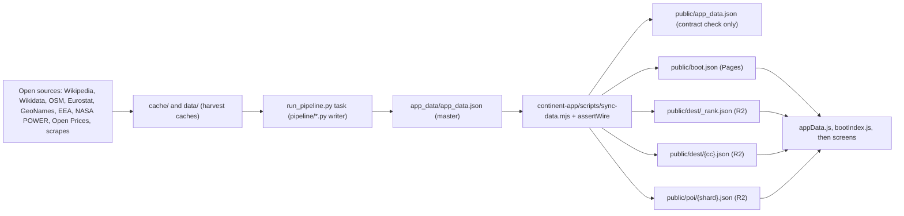

## Per wire field

Task tokens: `legacy` is a retired notebook or one-off, carried forward in the master (new places get it
from the manual inserter); `manual` is a script no `run_pipeline.py` task runs; `sync` is the wire build.
Readers: the three files with the most reads, then the total count of reading files. Where no read is
found and the name is specific (an underscore, or eight letters and not a common word), files that only name it are listed as "name only".

| Field | Source | Task | Artifact | Writer | Wire file | App readers |
|---|---|---|---|---|---|---|
| `meta.schema_version` | Carta (the contract version, 19) | `legacy` | app_data/app_data.json (master) | `pipeline/gen_mock_data.py` | boot.json (meta) | none found |
| `meta.currency` | Carta constant (EUR) | `legacy` | app_data/app_data.json (master) | `pipeline/gen_mock_data.py` | boot.json (meta) | none found |
| `meta.start_date` | Ryanair fare window of the first harvest (legacy notebook 02_flights) | `legacy` | app_data/app_data.json (master) | `pipeline/gen_mock_data.py` | boot.json (meta) | `src/lib/dates.js`, `src/planner/GuidedTripWizard.jsx` (2 files) |
| `meta.end_date` | Ryanair fare window of the first harvest (legacy notebook 02_flights) | `legacy` | app_data/app_data.json (master) | `pipeline/gen_mock_data.py` | boot.json (meta) | `src/lib/dates.js`, `src/planner/GuidedTripWizard.jsx` (2 files) |
| `meta.defaults` | Carta constants (group size, trip length, baggage, lifestyle) | `legacy` | app_data/app_data.json (master) | `pipeline/gen_mock_data.py` | boot.json (meta) | `src/hooks/useAppData.js`, `src/planner/finder/finderHooks.js`, `src/lib/wizardTransit.js` (6 files) |
| `meta.baggage_options` | Ryanair published bag fees (first harvest) | `legacy` | app_data/app_data.json (master) | `pipeline/gen_mock_data.py` | boot.json (meta) | `src/hooks/useAppData.js`, `src/lib/flights/bagFees.js` (2 files) |
| `meta.generated_at` | build clock | `fame`, `poi_significance` | app_data/app_data.json (master) | `pipeline/apply_rating_layer.py` | boot.json (meta) | name only: `src/components/admin/DataHealth.jsx`, `src/components/admin/LinkHealth.jsx`, `src/components/admin/PipelineOverrides.jsx` |
| `meta.origins` | Eurostat avia_par routes (T512): every European airport with a scheduled route | `flight_routes`, `sync` | data/flights/_airports.json | `continent-app/scripts/sync-data.mjs` | boot.json (meta) | `src/lib/origins.js`, `src/components/OriginPicker.jsx`, `src/components/FromPicker.jsx` (18 files) |
| `meta.home_city` | Carta constant (Brussels, the first home) | `legacy` | app_data/app_data.json (master) | `pipeline/gen_mock_data.py` | boot.json (meta) | none found |
| `meta.home` | Carta constant (Brussels coordinates) | `legacy` | app_data/app_data.json (master) | `pipeline/gen_mock_data.py` | boot.json (meta) | `src/lib/price/trip.js`, `src/hooks/useAppData.js`, `src/hooks/useDestinationSearch.js` (5 files) |
| `meta.categories` | Carta taxonomy | `legacy`, `manual` | app_data/app_data.json (master) | `pipeline/gen_mock_data.py`, `pipeline/apply_gem_categories.py` | boot.json (meta) | none found |
| `meta.cost_basket` | Numbeo anchors and Eurostat PLI (legacy notebook 03_costs) | `legacy` | app_data/app_data.json (master) | `pipeline/gen_mock_data.py` | boot.json (meta) | none found |
| `meta.cost_validation` | Numbeo anchors against the PLI scaling (legacy notebook 03_costs) | `legacy` | app_data/app_data.json (master) | `pipeline/oneoff/fix_data.py` | boot.json (meta) | none found |
| `meta.stays` | Booking and Hostelworld scrape journal (T1021) | `manual` | cache/stays build (pipeline/stays/common.py OUT) | `pipeline/stays/apply_stays.py` | boot.json (meta) | `src/lib/runtime_pricing.js`, `src/lib/staysData.js`, `src/App.jsx` (6 files) |
| `meta.food_model` | Open Prices, Eurostat HICP and PLI, Numbeo anchors (T513) | `food` | cache/food_price_inputs.json | `pipeline/apply_food_prices.py` | boot.json (meta) | none found |
| `meta.food_country` | Open Prices, Eurostat HICP and PLI, Numbeo anchors (T513) | `food` | cache/food_price_inputs.json | `pipeline/apply_food_prices.py` | boot.json (meta) | none found |
| `meta.car_model` | fuel prices, per-country toll tables, transit lines (GTFS, OSM ferries) | `transit_lines`, `manual` | cache/transit_lines.json | `pipeline/apply_car_layer.py`, `pipeline/apply_toll_layer.py` | boot.json (meta) | `src/lib/runtime_pricing.js`, `src/lib/price/car.js`, `src/hooks/useAppData.js` (7 files) |
| `meta.n_destinations` | count of the catalogue | `tourist_premium`, `legacy` | app_data/app_data.json (master) | `pipeline/apply_tourist_premium.py` | boot.json (meta) | none found |
| `meta.is_mock` | Carta flag (false on the real build) | `legacy` | app_data/app_data.json (master) | `pipeline/gen_mock_data.py` | boot.json (meta) | `src/App.jsx` (1 files) |
| `meta.beauty_model` | designations, nature and scenery signals (beauty layer) | `fame` | app_data/app_data.json (master) | `pipeline/apply_beauty_layer.py` | boot.json (meta) | none found |
| `meta.flight_model` | Ryanair monthly cheapest fares, densified (legacy notebook 02_flights) | `legacy` | app_data/app_data.json (master) | none in the repo | boot.json (meta) | none found |
| `meta.data_sources` | attribution entries appended by each harvest | `climate`, `guide`, `bathing_water`, `geonames`, `nature`, `crowding`, `crowding_uk`, `overture`, `poi_images_wikidata` | app_data/app_data.json (master) | `pipeline/apply_climate.py`, `pipeline/apply_wikivoyage.py`, `pipeline/harvest_bathing_water.py`, `pipeline/harvest_geonames.py`, `pipeline/harvest_protected_areas_osm.py`, `pipeline/harvest_tourism_density.py`, `pipeline/harvest_uk_crowds.py`, `pipeline/pois/harvest_pois_overture.py`, `pipeline/pois/harvest_pois_wikidata_images.py` | boot.json (meta) | none found |
| `meta.crowding_model` | Eurostat tour_occ_nin2m and nin3, ONS and VisitBritain nights | `crowding`, `crowding_uk` | cache/eurostat_nights_nuts2_monthly.json | `pipeline/harvest_tourism_density.py`, `pipeline/harvest_uk_crowds.py` | boot.json (meta) | none found |
| `meta.activities_model` | OpenTripMap, OSM, Wikidata sitelinks | `activities` | cache/activities.json | `pipeline/harvest_activities.py` | boot.json (meta) | none found |
| `meta.climate_model` | NASA POWER and Open-Meteo climate normals | `climate` | cache/climate.json | `pipeline/apply_climate.py` | boot.json (meta) | none found |
| `meta.climate_period` | the climate normals period of the climate cache | `sync` | cache/climate.json | `continent-app/scripts/sync-data.mjs` | boot.json (meta) | none found |
| `meta.country_context_model` | rating.score within each country | `country_context` | app_data/app_data.json (master) | `pipeline/country_context_layer.py` | boot.json (meta) | none found |
| `meta.designation_model` | UNESCO, EDEN, Plus Beaux Villages and other place registers (Wikidata) | `fame` | app_data/app_data.json (master) | `pipeline/apply_designations.py` | boot.json (meta) | none found |
| `meta.image_model` | Wikipedia and Wikimedia Commons lead images | `images` | cache/wiki_images.json | `pipeline/harvest_images.py` | boot.json (meta) | none found |
| `meta.member_model` | Wikidata landmarks and GeoNames towns | `manual` | cache/wikidata_landmarks.json | `pipeline/member_layer.py` | boot.json (meta) | none found |
| `meta.place_model` | GeoNames population, POI mix, place class rules | `fame` | app_data/app_data.json (master) | `pipeline/apply_place_layer.py` | boot.json (meta) | none found |
| `meta.rating_model` | the rating layer and continent-app/config/rating.json | `fame`, `poi_significance` | app_data/app_data.json (master) | `pipeline/apply_rating_layer.py` | boot.json (meta) | none found |
| `meta.tourist_premium_model` | Eurostat nights per NUTS3 against the country base | `tourist_premium` | app_data/app_data.json (master) | `pipeline/apply_tourist_premium.py` | boot.json (meta) | none found |
| `destinations.*.id` | Carta catalogue (IATA code or gem:slug) | `legacy`, `manual` | app_data/app_data.json (master) | `pipeline/oneoff/add_famous_small_gems.py` | boot.json (id) | `src/auth/SavedTripsPanel.jsx`, `src/browse/DestinationPage.jsx`, `src/planner/finder/finderText.js` (226 files) |
| `destinations.*.tier` | Carta catalogue (airport, gem, longtail) | `legacy`, `manual` | app_data/app_data.json (master) | `pipeline/oneoff/add_famous_small_gems.py` | boot.json (f (flag AIRPORT)), dest/_rank.json, dest/{cc}.json | `src/browse/ExploreMap.jsx`, `src/lib/linking/aliases.js`, `src/components/admin/UsersList.jsx` (28 files) |
| `destinations.*.iata` | Ryanair airport list, then the catalogue | `legacy`, `manual` | app_data/app_data.json (master) | `pipeline/oneoff/add_famous_small_gems.py` | dest/_rank.json, dest/{cc}.json | `src/lib/airportReach.js`, `src/components/AirportReach.jsx`, `src/planner/wizard/OriginCard.jsx` (23 files) |
| `destinations.*.city` | Carta catalogue (display name) | `legacy`, `manual` | app_data/app_data.json (master) | `pipeline/oneoff/add_famous_small_gems.py` | dest/_rank.json, dest/{cc}.json | `src/planner/TripItinerary.jsx`, `src/auth/PastTripForm.jsx`, `src/lib/tripExport.js` (157 files) |
| `destinations.*.country` | Carta catalogue | `legacy`, `manual` | app_data/app_data.json (master) | `pipeline/oneoff/add_famous_small_gems.py` | dest/_rank.json, dest/{cc}.json | `src/planner/wizard/StepWhere.jsx`, `src/components/FromPicker.jsx`, `src/planner/DayPlannerTab.jsx` (109 files) |
| `destinations.*.iso2` | Carta catalogue (ISO 3166 code) | `legacy`, `manual` | app_data/app_data.json (master) | `pipeline/oneoff/add_famous_small_gems.py`, `pipeline/gen_mock_data.py` | boot.json (cc) | `src/browse/DestinationPage.jsx`, `src/components/FromPicker.jsx`, `src/lib/price/trip.js` (89 files) |
| `destinations.*.lat` | Wikipedia coordinates or the GeoNames gazetteer | `legacy`, `manual` | app_data/app_data.json (master) | `pipeline/oneoff/add_famous_small_gems.py` | boot.json (lat) | `src/planner/dayDraft.js`, `src/lib/cityResearch.js`, `src/planner/DayPlannerTab.jsx` (116 files) |
| `destinations.*.lon` | Wikipedia coordinates or the GeoNames gazetteer | `legacy`, `manual` | app_data/app_data.json (master) | `pipeline/oneoff/add_famous_small_gems.py` | boot.json (lon) | `src/lib/cityResearch.js`, `src/planner/dayDraft.js`, `src/browse/DestMap.jsx` (109 files) |
| `destinations.*.categories` | Carta taxonomy plus hand overrides | `legacy`, `manual` | pipeline/gem_category_overrides.py | `pipeline/oneoff/add_famous_small_gems.py`, `pipeline/apply_gem_categories.py` | boot.json (f (flag UNESCO)), dest/_rank.json, dest/{cc}.json | `src/hooks/useDestinationSearch.js`, `src/lib/countryMatch.js`, `src/hooks/useExploreCatalog.js` (16 files) |
| `destinations.*.tags` | Carta catalogue | `legacy`, `manual` | app_data/app_data.json (master) | `pipeline/oneoff/add_famous_small_gems.py` | dest/_rank.json, dest/{cc}.json | `src/lib/taste/profile.js`, `src/lib/beachStory.js`, `src/lib/countryMatch.js` (3 files) |
| `destinations.*.blurb` | hand-written or Wikipedia lead, per catalogue batch | `legacy`, `manual` | app_data/app_data.json (master) | `pipeline/oneoff/add_famous_small_gems.py`, `pipeline/promote_place_candidates.py` | dest/_rank.json, dest/{cc}.json | `src/lib/ask/compose.js`, `src/lib/knownFor.js`, `src/lib/ask/context.js` (8 files) |
| `destinations.*.no_ryanair_route` | Ryanair route list and the drive radius | `airports`, `legacy` | app_data/app_data.json (master) | `pipeline/apply_airport_anchors.py`, `pipeline/oneoff/add_famous_small_gems.py` | dest/_rank.json, dest/{cc}.json | name only: `src/lib/cityResearch.js` |
| `destinations.*.anchor_airport` | nearest served airport within 50 km | `airports`, `legacy` | app_data/app_data.json (master) | `pipeline/apply_airport_anchors.py`, `pipeline/oneoff/add_famous_small_gems.py` | dest/_rank.json, dest/{cc}.json | `src/planner/TripItinerary.jsx`, `src/hooks/useDestinationSearch.js`, `src/lib/linking/aliases.js` (8 files) |
| `destinations.*.costs` | Open Prices, Eurostat HICP and PLI, Numbeo anchors; tourist premium from Eurostat nights | `food`, `tourist_premium` | cache/food_price_inputs.json | `pipeline/apply_food_prices.py`, `pipeline/apply_tourist_premium.py` | dest/_rank.json, dest/{cc}.json | `src/browse/DestFood.jsx`, `src/lib/costIndex.js`, `src/lib/budgetSearch.js` (9 files) |
| `destinations.*.accommodation` | Booking and Hostelworld scrape journal (T1021) | `manual` | cache/stays build (pipeline/stays/common.py OUT) | `pipeline/stays/apply_stays.py` | dest/_rank.json, dest/{cc}.json | `src/lib/stayPrice.js`, `src/browse/DestinationPage.jsx`, `src/lib/budgetSearch.js` (11 files) |
| `destinations.*.local_transport` | OSM road network, GTFS lines, OSM ferry legs, OSM parking | `transit_lines` | cache/transit_lines.json | `pipeline/apply_car_layer.py` | dest/_rank.json, dest/{cc}.json | `src/lib/runtime_pricing.js`, `src/lib/ask/rank.js`, `src/lib/mobility.js` (17 files) |
| `destinations.*.beauty` | designations, protected areas, coast and relief signals | `fame` | app_data/app_data.json (master) | `pipeline/apply_beauty_layer.py` | dest/_rank.json, dest/{cc}.json | `src/hooks/useDestinationSearch.js`, `src/lib/knownFor.js`, `src/lib/trip_planner_pricing.js` (12 files) |
| `destinations.*.image` | Wikipedia and Wikimedia Commons lead images | `images`, `hero_audit` | cache/wiki_images.json | `pipeline/harvest_images.py`, `pipeline/audit/audit_hero_images.py` | dest/_rank.json, dest/{cc}.json | `src/browse/explore/useExploreRails.js`, `src/lib/countryBrief.js`, `src/lib/recommend/persona.js` (53 files) |
| `destinations.*.activities` | OpenTripMap, OSM, Overture Places, Wikidata, Wikivoyage listings | `activities`, `overture`, `poi_significance`, `poi_descriptions`, `poi_images_wikidata` | cache/activities.json | `pipeline/harvest_activities.py`, `pipeline/pois/harvest_pois_overture.py`, `pipeline/score_significance.py`, `pipeline/poi_labels.py`, `pipeline/backfill_landmarks.py` | dest/{cc}.json, poi/{shard}.json (items_full) | `src/lib/tripGuide.js`, `src/lib/trip_planner_pricing.js`, `src/planner/DayPlannerTab.jsx` (15 files) |
| `destinations.*.rating` | fame (pageviews), designations, beauty, place class, POI rates | `fame`, `poi_significance` | cache/dest_pageviews.json | `pipeline/apply_rating_layer.py` | boot.json (f (flag HIDDEN_GEM), r (band)), dest/_rank.json, dest/{cc}.json | `src/lib/countryMatch.js`, `src/browse/PlaceOverview.jsx`, `src/browse/explore/useExploreRails.js` (66 files) |
| `destinations.*.gateways` | multi-airport city table (T755) | `fame`, `poi_significance` | app_data/app_data.json (master) | `pipeline/rating_layer.py` | dest/{cc}.json | name only: `src/browse/JourneyPage.jsx`, `src/browse/cartaFlight.js`, `src/browse/explore/ExploreContent.jsx` |
| `destinations.*.taste` | rating, nature tiers, guided-search areas | `rating_v5_profile` | public/search/guided.json | `pipeline/place_taste_profile.py` | dest/_rank.json, dest/{cc}.json | `src/lib/recommend/persona.js`, `src/auth/account/TravelView.jsx`, `src/hooks/useExploreCatalog.js` (11 files) |
| `destinations.*.gateway_of` | multi-airport city table (T755) | `fame`, `poi_significance` | app_data/app_data.json (master) | `pipeline/rating_layer.py` | boot.json (f (flag GATEWAY)), dest/_rank.json, dest/{cc}.json | `src/lib/linking/aliases.js`, `src/lib/rating.js`, `src/lib/recommend/persona.js` (8 files) |
| `destinations.*.transfer` | road distance to the anchor airport (about 0.15 EUR per km) | `legacy`, `airports` | app_data/app_data.json (master) | `pipeline/oneoff/add_famous_small_gems.py`, `pipeline/apply_airport_anchors.py` | dest/_rank.json, dest/{cc}.json | `src/lib/origins.js`, `src/lib/recommend/candidates.js`, `src/lib/wayChoice.js` (3 files) |
| `destinations.*.climate` | NASA POWER, Open-Meteo, sea temperature | `climate`, `climate_daily` | cache/climate.json | `pipeline/apply_climate.py` | dest/_rank.json, dest/{cc}.json | `src/browse/DestWhen.jsx`, `src/lib/ask/rank.js`, `src/lib/packing.js` (21 files) |
| `destinations.*.place` | GeoNames population, POI mix, place class rules | `fame` | app_data/app_data.json (master) | `pipeline/apply_place_layer.py` | dest/_rank.json, dest/{cc}.json | `src/lib/destinationPdf.js`, `src/lib/countryMatch.js`, `src/lib/taxonomy.js` (22 files) |
| `destinations.*.country_rank` | rating.score within the country | `country_context` | app_data/app_data.json (master) | `pipeline/country_context_layer.py` | dest/_rank.json, dest/{cc}.json | `src/browse/CountryPage.jsx`, `src/hooks/useExploreCatalog.js`, `src/hooks/usePlaceRows.js` (3 files) |
| `destinations.*.country_n` | rating.score within the country | `country_context` | app_data/app_data.json (master) | `pipeline/country_context_layer.py` | dest/_rank.json, dest/{cc}.json | `src/hooks/useExploreCatalog.js` (1 files) |
| `destinations.*.country_percentile` | rating.score within the country | `country_context` | app_data/app_data.json (master) | `pipeline/country_context_layer.py` | dest/{cc}.json | none found |
| `destinations.*.country_badge` | rating.score within the country | `country_context` | app_data/app_data.json (master) | `pipeline/country_context_layer.py` | dest/_rank.json, dest/{cc}.json | `src/browse/CountryPage.jsx`, `src/browse/explore/useExploreRows.js`, `src/hooks/useExploreCatalog.js` (4 files) |
| `destinations.*.class_percentile` | rating.score within the country and place class | `country_context` | app_data/app_data.json (master) | `pipeline/country_context_layer.py` | dest/{cc}.json | none found |
| `destinations.*.city_lat` | Wikipedia city centre coordinates | `manual` | app_data/app_data.json (master) | `pipeline/oneoff/apply_city_center.py` | dest/_rank.json, dest/{cc}.json | `src/auth/PastTripForm.jsx`, `src/auth/SavedTripsPanel.jsx`, `src/auth/foreignTrip.js` (28 files) |
| `destinations.*.city_lon` | Wikipedia city centre coordinates | `manual` | app_data/app_data.json (master) | `pipeline/oneoff/apply_city_center.py` | dest/_rank.json, dest/{cc}.json | `src/auth/PastTripForm.jsx`, `src/auth/SavedTripsPanel.jsx`, `src/auth/foreignTrip.js` (28 files) |
| `destinations.*.driving_toll` | per-country toll and vignette tables (toll_layer.py) | `manual` | app_data/app_data.json (master) | `pipeline/apply_toll_layer.py` | dest/_rank.json, dest/{cc}.json | `src/lib/runtime_pricing.js`, `src/browse/TripPractical.jsx` (2 files) |
| `destinations.*.bathing_water` | EEA bathing water directive results | `bathing_water` | cache/eea_bathing_water.json | `pipeline/harvest_bathing_water.py` | dest/_rank.json, dest/{cc}.json | `src/browse/PlaceOverview.jsx`, `src/components/WaterQualityBadge.jsx`, `src/hooks/useDestinationSearch.js` (6 files) |
| `destinations.*.crowding` | Eurostat nights per NUTS2 and NUTS3, ONS and VisitBritain for the UK | `crowding`, `crowding_uk` | cache/eurostat_nights_nuts2_monthly.json | `pipeline/harvest_tourism_density.py`, `pipeline/harvest_uk_crowds.py` | dest/_rank.json, dest/{cc}.json | `src/lib/countryMatch.js`, `src/browse/DestWhen.jsx`, `src/lib/ask/rank.js` (13 files) |
| `destinations.*.geonames` | GeoNames cities dump | `geonames` | cache/geonames | `pipeline/harvest_geonames.py` | dest/{cc}.json | `src/lib/knownFor.js`, `src/lib/cityResearch.js`, `src/lib/linking/aliases.js` (3 files) |
| `destinations.*.designations` | UNESCO, EDEN, Plus Beaux Villages and other registers (Wikidata) | `fame` | app_data/app_data.json (master) | `pipeline/apply_designations.py` | dest/{cc}.json | `src/browse/DestinationPage.jsx` (1 files) |
| `destinations.*.nature` | OSM protected areas (Overpass) | `nature` | cache/osm_protected_areas.json | `pipeline/harvest_protected_areas_osm.py` | dest/{cc}.json | `src/lib/knownFor.js`, `src/lib/packing.js`, `src/planner/aiCitySuggest.js` (3 files) |
| `destinations.*.guide` | Wikivoyage lead and link (CC BY-SA) | `guide` | cache/wikivoyage.json | `pipeline/apply_wikivoyage.py` | dest/{cc}.json | `src/browse/DestinationPage.jsx`, `src/planner/flow/tellChips.js` (2 files) |
| `destinations.*.members` | Wikidata landmarks and GeoNames towns grouped under a place | `manual` | cache/wikidata_landmarks.json | `pipeline/member_layer.py` | dest/{cc}.json | `src/browse/DestinationPage.jsx`, `src/lib/linking/search.js`, `src/together/groupBand.js` (3 files) |
| `destinations.*.wikidata` | Wikidata Special:EntityData (CC0) | `legacy` | app_data/app_data.json (master) | none in the repo | dest/{cc}.json | name only: `src/browse/BeachPage.jsx`, `src/browse/LakePage.jsx`, `src/browse/MountainPage.jsx` |
| `destinations.*.season` | OSM opening_hours and seasonal tags (Geofabrik extracts) | `seasons` | cache/dest_seasons.json | `pipeline/harvest_seasons.py` | dest/_rank.json, dest/{cc}.json | `src/browse/SectionOpening.jsx`, `src/browse/DestWhen.jsx`, `src/lib/runtime_pricing.js` (4 files) |
| `destinations.*.anchor_estimated` | nearest served airport within 50 km (auto-anchor) | `airports` | app_data/app_data.json (master) | `pipeline/apply_airport_anchors.py` | dest/_rank.json, dest/{cc}.json | none found |

Notes:

- `meta.schema_version`: Bumped by hand in the master by the task that changes the contract (docs/SCHEMA.md); pinned in continent-app/scripts/ci/contract.mjs.
- `meta.origins`: Replaced on every wire build from the flight route list; the master's copy is not used.
- `meta.stays`: The stays task publishes stays-live to R2 only; baking a build into the master is apply_stays.py by hand.
- `meta.flight_model`: Recorded by the retired fix_data.py step of legacy notebook 02_flights (docs/SCHEMA.md, Flight data provenance); no script in the repo writes the block today, it is carried forward in the master. The app prices flights from the T511 to T518 route and fare files instead.
- `destinations.*.id`: New places: coverage proposes, promote_place_candidates.py writes a spec, apply_new_gems.py inserts it by hand (an editorial act, never scheduled).
- `destinations.*.accommodation`: Schema v18. The monthly stays task refreshes only the R2 stays-live wire; the compact block in the master moves when apply_stays.py is run by hand.
- `destinations.*.image`: sync-data.mjs strips image.hires on the wire.
- `destinations.*.activities`: sync-data.mjs moves activities.items_full to public/poi/{shard}.json.
- `destinations.*.guide`: sync-data.mjs trims the lead to a short blurb on the wire.
- `destinations.*.wikidata`: On 43 places of the 2026-07c gem batch; the harvest that wrote it is retired (archive/harvest_osm_wikidata.py), so it is carried forward in the master.
- `destinations.*.season`: T1202 (D18): present only on places with seasonal facts; presence pending until the first run.

## Per pipeline task

One diagram per task that writes a wire field or a wire file: commands, then what reaches the wire.

### `fame` (monthly)

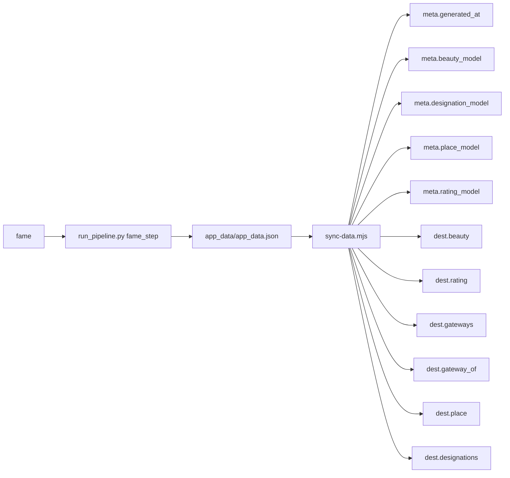

### `poi_significance` (monthly)

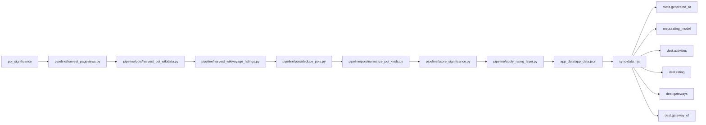

### `country_context` (weekly)

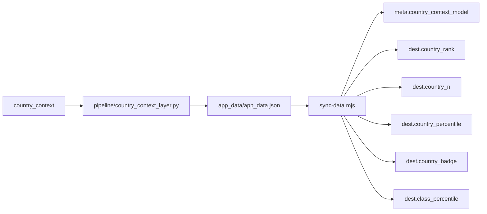

### `bathing_water` (quarterly)

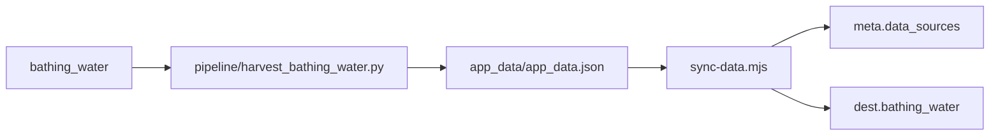

### `beaches` (quarterly)

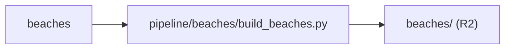

### `lakes` (quarterly)

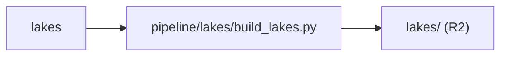

### `mountains` (quarterly)


### `trips` (monthly)


### `joins` (after)


### `regions` (quarterly)

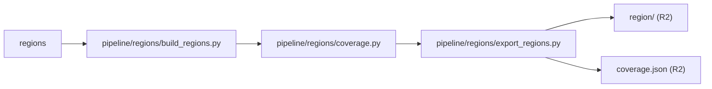

### `crowding` (quarterly)

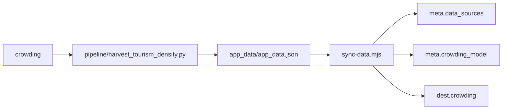

### `crowding_uk` (quarterly)

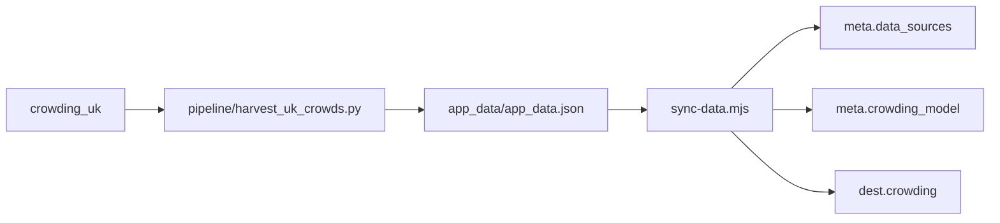

### `flight_routes` (monthly)

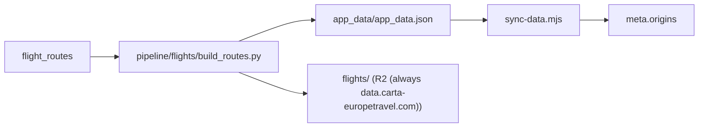

### `tourist_premium` (quarterly)

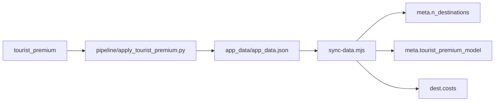

### `food` (monthly)

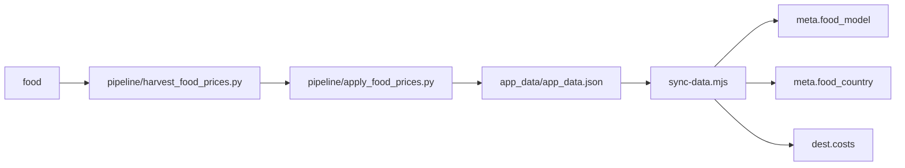

### `stays` (monthly)


### `trails_rate` (after)


### `cycling_publish` (after)


### `geonames` (backfill)

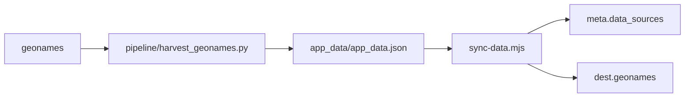

### `nature` (backfill)

```mermaid
flowchart LR
  T_nature["nature"]
  C0["pipeline/harvest_protected_areas_osm.py"]
  T_nature --> C0
  M["app_data/app_data.json"]
  C0 --> M
  S["sync-data.mjs"]
  M --> S
  F0["meta.data_sources"]
  S --> F0
  F1["dest.nature"]
  S --> F1
```

### `climate` (backfill)

```mermaid
flowchart LR
  T_climate["climate"]
  C0["pipeline/harvest_climate_power.py"]
  T_climate --> C0
  C1["pipeline/apply_climate.py"]
  C0 --> C1
  M["app_data/app_data.json"]
  C1 --> M
  S["sync-data.mjs"]
  M --> S
  F0["meta.data_sources"]
  S --> F0
  F1["meta.climate_model"]
  S --> F1
  F2["dest.climate"]
  S --> F2
```

### `guide` (backfill)

```mermaid
flowchart LR
  T_guide["guide"]
  C0["pipeline/harvest_wikivoyage.py"]
  T_guide --> C0
  C1["pipeline/apply_wikivoyage.py"]
  C0 --> C1
  M["app_data/app_data.json"]
  C1 --> M
  S["sync-data.mjs"]
  M --> S
  F0["meta.data_sources"]
  S --> F0
  F1["dest.guide"]
  S --> F1
```

### `images` (backfill)

```mermaid
flowchart LR
  T_images["images"]
  C0["pipeline/harvest_images.py"]
  T_images --> C0
  M["app_data/app_data.json"]
  C0 --> M
  S["sync-data.mjs"]
  M --> S
  F0["meta.image_model"]
  S --> F0
  F1["dest.image"]
  S --> F1
```

### `hero_audit` (monthly)

```mermaid
flowchart LR
  T_hero_audit["hero_audit"]
  C0["pipeline/audit/audit_hero_images.py"]
  T_hero_audit --> C0
  M["app_data/app_data.json"]
  C0 --> M
  S["sync-data.mjs"]
  M --> S
  F0["dest.image"]
  S --> F0
```

### `events` (monthly)

```mermaid
flowchart LR
  T_events["events"]
  C0["pipeline/harvest_events.py"]
  T_events --> C0
  C1["pipeline/export_destinfo.py"]
  C0 --> C1
  W0["destinfo/ (R2)"]
  C1 --> W0
```

### `parking` (quarterly)

```mermaid
flowchart LR
  T_parking["parking"]
  C0["pipeline/harvest_parking.py"]
  T_parking --> C0
  C1["pipeline/export_destinfo.py"]
  C0 --> C1
  W0["destinfo/ (R2)"]
  C1 --> W0
```

### `activities` (backfill)

```mermaid
flowchart LR
  T_activities["activities"]
  C0["pipeline/harvest_activities.py"]
  T_activities --> C0
  M["app_data/app_data.json"]
  C0 --> M
  S["sync-data.mjs"]
  M --> S
  F0["meta.activities_model"]
  S --> F0
  F1["dest.activities"]
  S --> F1
```

### `overture` (backfill)

```mermaid
flowchart LR
  T_overture["overture"]
  C0["pipeline/pois/harvest_pois_overture.py"]
  T_overture --> C0
  M["app_data/app_data.json"]
  C0 --> M
  S["sync-data.mjs"]
  M --> S
  F0["meta.data_sources"]
  S --> F0
  F1["dest.activities"]
  S --> F1
```

### `poi_images_wikidata` (backfill)

```mermaid
flowchart LR
  T_poi_images_wikidata["poi_images_wikidata"]
  C0["pipeline/pois/harvest_pois_wikidata_images.py"]
  T_poi_images_wikidata --> C0
  M["app_data/app_data.json"]
  C0 --> M
  S["sync-data.mjs"]
  M --> S
  F0["meta.data_sources"]
  S --> F0
  F1["dest.activities"]
  S --> F1
```

### `transit_lines` (monthly)

```mermaid
flowchart LR
  T_transit_lines["transit_lines"]
  C0["pipeline/transit/gtfs_lines.py"]
  T_transit_lines --> C0
  C1["pipeline/transit/osm_ferry_legs.py"]
  C0 --> C1
  C2["pipeline/transit/merge_lines.py"]
  C1 --> C2
  C3["pipeline/apply_car_layer.py"]
  C2 --> C3
  M["app_data/app_data.json"]
  C3 --> M
  S["sync-data.mjs"]
  M --> S
  F0["meta.car_model"]
  S --> F0
  F1["dest.local_transport"]
  S --> F1
```

### `airports` (quarterly)

```mermaid
flowchart LR
  T_airports["airports"]
  C0["pipeline/apply_airport_anchors.py"]
  T_airports --> C0
  M["app_data/app_data.json"]
  C0 --> M
  S["sync-data.mjs"]
  M --> S
  F0["dest.no_ryanair_route"]
  S --> F0
  F1["dest.anchor_airport"]
  S --> F1
  F2["dest.transfer"]
  S --> F2
  F3["dest.anchor_estimated"]
  S --> F3
```

### `climate_daily` (quarterly)

```mermaid
flowchart LR
  T_climate_daily["climate_daily"]
  C0["pipeline/harvest_climate_power.py"]
  T_climate_daily --> C0
  M["app_data/app_data.json"]
  C0 --> M
  S["sync-data.mjs"]
  M --> S
  F0["dest.climate"]
  S --> F0
```

### `beach_context` (quarterly)

```mermaid
flowchart LR
  T_beach_context["beach_context"]
  C0["pipeline/beaches/enrich_beaches.py"]
  T_beach_context --> C0
  C1["pipeline/beaches/harvest_beach_walks.py"]
  C0 --> C1
  C2["pipeline/beaches/export_beaches.py"]
  C1 --> C2
  W0["beaches/ (R2)"]
  C2 --> W0
```

### `peak_context` (quarterly)

```mermaid
flowchart LR
  T_peak_context["peak_context"]
  C0["pipeline/mountains/enrich_peaks.py"]
  T_peak_context --> C0
  C1["pipeline/mountains/harvest_lift_hours.py"]
  C0 --> C1
  C2["pipeline/mountains/export_peaks.py"]
  C1 --> C2
  W0["mountains/ (R2)"]
  C2 --> W0
```

### `lake_detail` (quarterly)

```mermaid
flowchart LR
  T_lake_detail["lake_detail"]
  C0["pipeline/lakes/enrich_lakes.py"]
  T_lake_detail --> C0
  C1["pipeline/lakes/lake_outlines.py"]
  C0 --> C1
  C2["pipeline/lakes/harvest_water_detail.py"]
  C1 --> C2
  C3["pipeline/lakes/export_lakes.py"]
  C2 --> C3
  W0["lakes/ (R2)"]
  C3 --> W0
```

### `trails_fields` (quarterly)

```mermaid
flowchart LR
  T_trails_fields["trails_fields"]
  C0["pipeline/trails/way_tags.py"]
  T_trails_fields --> C0
  C1["pipeline/trails/transit_stops.py"]
  C0 --> C1
  C2["pipeline/trails/export_wire.py"]
  C1 --> C2
  C3["pipeline/cycling/export_cycling.py"]
  C2 --> C3
  W0["trails/ (R2)"]
  C3 --> W0
  W1["cycling/ (R2)"]
  C3 --> W1
```

### `rating_v5_profile` (weekly)

```mermaid
flowchart LR
  T_rating_v5_profile["rating_v5_profile"]
  C0["pipeline/nature_tiers.py"]
  T_rating_v5_profile --> C0
  C1["pipeline/place_taste_profile.py"]
  C0 --> C1
  M["app_data/app_data.json"]
  C1 --> M
  S["sync-data.mjs"]
  M --> S
  F0["dest.taste"]
  S --> F0
  W0["trails/ (R2)"]
  C1 --> W0
  W1["cycling/ (R2)"]
  C1 --> W1
  W2["beaches/ (R2)"]
  C1 --> W2
  W3["lakes/ (R2)"]
  C1 --> W3
  W4["mountains/ (R2)"]
  C1 --> W4
```

### `outdoor_pages` (weekly)

```mermaid
flowchart LR
  T_outdoor_pages["outdoor_pages"]
  C0["pipeline/outdoor/derive_outdoor_pages.py"]
  T_outdoor_pages --> C0
  W0["trails/ (R2)"]
  C0 --> W0
  W1["cycling/ (R2)"]
  C0 --> W1
```

### `poi_descriptions` (quarterly)

```mermaid
flowchart LR
  T_poi_descriptions["poi_descriptions"]
  C0["pipeline/poi_descriptions.py"]
  T_poi_descriptions --> C0
  M["app_data/app_data.json"]
  C0 --> M
  S["sync-data.mjs"]
  M --> S
  F0["dest.activities"]
  S --> F0
```

### `dossier` (monthly)

```mermaid
flowchart LR
  T_dossier["dossier"]
  C0["pipeline/dossier/harvest_landmarks.py"]
  T_dossier --> C0
  C1["pipeline/dossier/reclassify_landmarks.py"]
  C0 --> C1
  C2["pipeline/dossier/harvest_city_intros.py"]
  C1 --> C2
  C3["pipeline/dossier/fix_airport_listings.py"]
  C2 --> C3
  C4["pipeline/dossier/harvest_event_dates.py"]
  C3 --> C4
  C5["pipeline/export_destinfo.py"]
  C4 --> C5
  C6["pipeline/dossier/web_sweep.py"]
  C5 --> C6
  C7["pipeline/dossier/plan_research.py"]
  C6 --> C7
  C8["pipeline/dossier/research_do.py"]
  C7 --> C8
  C9["pipeline/dossier/build_dossier.py"]
  C8 --> C9
  W0["dossier/ (R2)"]
  C9 --> W0
  W1["destinfo/ (R2)"]
  C9 --> W1
```

### `guided_search` (after)

```mermaid
flowchart LR
  T_guided_search["guided_search"]
  C0["pipeline/guided_search_layer.py"]
  T_guided_search --> C0
  W0["search/ (R2)"]
  C0 --> W0
```

### `ask_index` (after)

```mermaid
flowchart LR
  T_ask_index["ask_index"]
  C0["pipeline/ask_index_layer.py"]
  T_ask_index --> C0
  C1["continent-app/scripts/build-ask-bm25.mjs"]
  C0 --> C1
  W0["search/ask/ (Pages)"]
  C1 --> W0
```

### `entry_rules` (monthly)

```mermaid
flowchart LR
  T_entry_rules["entry_rules"]
  C0["pipeline/entry_rules.py"]
  T_entry_rules --> C0
  W0["entry_rules.json (Pages)"]
  C0 --> W0
```

### `seasons` (quarterly)

```mermaid
flowchart LR
  T_seasons["seasons"]
  C0["pipeline/harvest_seasons.py"]
  T_seasons --> C0
  M["app_data/app_data.json"]
  C0 --> M
  S["sync-data.mjs"]
  M --> S
  F0["dest.season"]
  S --> F0
```

### `trailslab_worker` (weekly)

```mermaid
flowchart LR
  T_trailslab_worker["trailslab_worker"]
  C0["infra/hetzner/cax41/trailslab_worker.py"]
  T_trailslab_worker --> C0
  W0["trails/ (R2)"]
  C0 --> W0
```

### Tasks that write no wire field or wire file

These feed caches, reports or other tasks (their output reaches the wire through a task above, or not at all).

`ingestion`, `demand_events`, `coverage`, `register_intake`, `audit`, `routes_attach`, `trails_ingest`, `trails_elevation`, `trails_validate`, `trails_popularity`, `trails_registry`, `trails_splice`, `trails_route_bridge`, `trails_regionize`, `trails_derive_routes`, `trails_hierarchy`, `trails_curate`, `trails_forests`, `trails_scenic`, `trails_images`, `trails_way_tags`, `trails_attributes`, `trails_summaries`, `cycling_harvest`, `cycling_enrich`, `cycling_photos`, `cycling_bridge`, `unesco`, `image_audit`, `access_facts`, `must_descs`, `poi_images`, `sea_temp`, `heat_fire`, `dest_overlays`, `poi_fees`, `place_intros`, `place_gallery`, `field_stubs_report`, `taxonomy_tags`, `intel_tags`, `blog_drafts`, `blog_pr`, `link_health`, `photo_check`, `price_alerts`, `photo_sources`

## Wire files beside the contract

The contract covers `app_data.json`. The other folders the app fetches, with the task and writer behind each.

| Wire path (under `public/`) | Task | Writer | Host | App reader | What |
|---|---|---|---|---|---|
| `boot.json` | `sync` | `continent-app/scripts/sync-data.mjs` | Pages | `src/lib/appData.js`, `src/lib/bootIndex.js` | meta plus one row per place: id, lat, lon, country code, flags, rating band |
| `dest/_rank.json` | `sync` | `continent-app/scripts/sync-data.mjs` | R2 | `src/lib/appData.js`, `src/lib/bootIndex.js` | the rank tier: RANK_FIELDS of every place, columnar |
| `dest/{cc}.json` | `sync` | `continent-app/scripts/sync-data.mjs` | R2 | `src/lib/appData.js` | the rest of each record, one file per country or tile |
| `poi/{shard}.json` | `sync` | `continent-app/scripts/sync-data.mjs` | R2 | `src/lib/appData.js` | activities.items_full of one place |
| `app_data.json` | `sync` | `continent-app/scripts/sync-data.mjs` | none (not fetched) | `scripts/ci/check-contract.mjs` | the whole wire; input of the contract check and the harnesses |
| `country_insights.json` | `sync` | `continent-app/scripts/sync-data.mjs` | Pages | `src/lib/appData.js`, `src/hooks/useCountryInsights.js` | per-country intel, copied from app_data/country_insights.json |
| `entry_rules.json` | `entry_rules` | `pipeline/entry_rules.py` | Pages | `src/lib/entryRules.js`, `scripts/ci/check-contract.mjs` | entry rules per country and traveller group, with source and date checked (T1199, D19) |
| `dossier/` | `dossier` | `pipeline/dossier/build_dossier.py` | R2 | `src/lib/dossier.js` | the per-place contract for the place page and the PDF |
| `destinfo/` | `events`, `parking`, `dossier` | `pipeline/export_destinfo.py` | R2 | `src/lib/destInfo.js` | events, parking and practical facts per place (loader exists, no screen calls it today) |
| `trips/` | `trips` | `pipeline/trips/build_trips.py` | R2 | `src/lib/trips.js` | ready-made 2 to 14 day trips |
| `journeys/` | `manual` | `pipeline/journeys/build_wire.py` | R2 | `src/lib/journeys.js` | library journeys |
| `trails/` | `trails_rate`, `trails_fields`, `trailslab_worker`, `rating_v5_profile`, `outdoor_pages` | `pipeline/trails/export_wire.py` | R2 | `src/lib/trails.js` | rated trails per country and their pages |
| `cycling/` | `cycling_publish`, `trails_fields`, `rating_v5_profile`, `outdoor_pages` | `pipeline/cycling/export_cycling.py` | R2 | `src/lib/cycling.js` | cycle routes and stages |
| `beaches/` | `beaches`, `beach_context`, `rating_v5_profile` | `pipeline/beaches/export_beaches.py` | R2 | `src/browse/BeachPage.jsx` | beaches per country |
| `lakes/` | `lakes`, `lake_detail`, `rating_v5_profile` | `pipeline/lakes/export_lakes.py` | R2 | `src/browse/LakePage.jsx` | lakes per country |
| `mountains/` | `mountains`, `peak_context`, `rating_v5_profile` | `pipeline/mountains/export_peaks.py` | R2 | `src/browse/MountainPage.jsx` | peaks per country |
| `region/` | `regions` | `pipeline/regions/export_regions.py` | R2 | `src/lib/regions.js` | regions and their members |
| `search/` | `guided_search` | `pipeline/guided_search_layer.py` | R2 | `src/lib/guidedData.js` | guided search areas, distances and vibes |
| `search/ask/` | `ask_index` | `pipeline/ask_index_layer.py` | Pages | `functions/api/ask.js` | Ask Carta passages, vectors and BM25 |
| `stays/` | `manual` | `pipeline/stays/apply_stays.py` | R2 | `src/lib/staysData.js` | bed prices per country baked into a build |
| `stays-live/` | `stays` | `pipeline/stays/box_stays.py` | R2 | `src/lib/staysData.js` | the monthly bed price refresh, read without a deploy |
| `reach/` | `manual` | `tools/reachability/build_reach.py` | R2 | `src/lib/reach.js` | travel time tables per origin |
| `coverage.json` | `regions` | `pipeline/regions/coverage.py` | R2 | `src/lib/regions.js` | coverage per region |
| `search_index.json` | `manual` | `pipeline/search_index_layer.py` | R2 | `src/lib/searchIndex.js`, `src/hooks/useDestinationSearch.js` | the search box index |
| `poi_credits.json` | `manual` | `pipeline/photos/export_poi_credits.py` | R2 | `src/lib/imageCredit.js` | photo credits for POIs |
| `joins.json` | `joins` | `pipeline/joins/neighbours.py` | Pages |  | nearby things for each place (no app code fetches it today) |
| `flights/` | `flight_routes` | `continent-app/workers/flight-sweep/wrangler.toml` | R2 (always data.carta-europetravel.com) | `src/lib/flights/flightData.js` | per-airport fares written to R2 by the flight-sweep Worker from the route list pipeline/flights/build_routes.py builds; never in public/ |
| `europe_map.json` | `manual` | `pipeline/oneoff/build_europe_map.py` | Pages | `src/auth/mytrips/YourEurope.jsx` | the My trips map outline |

## Gaps this lineage shows

- Shipped but no app reader found (26): `meta.schema_version`, `meta.currency`, `meta.home_city`, `meta.categories`, `meta.cost_basket`, `meta.cost_validation`, `meta.food_model`, `meta.food_country`, `meta.n_destinations`, `meta.beauty_model`, `meta.flight_model`, `meta.data_sources`, `meta.crowding_model`, `meta.activities_model`, `meta.climate_model`, `meta.climate_period`, `meta.country_context_model`, `meta.designation_model`, `meta.image_model`, `meta.member_model`, `meta.place_model`, `meta.rating_model`, `meta.tourist_premium_model`, `destinations.*.country_percentile`, `destinations.*.class_percentile`, `destinations.*.anchor_estimated`.
- Written by a script no task schedules (20): `meta.categories`, `meta.stays`, `meta.car_model`, `meta.member_model`, `destinations.*.id`, `destinations.*.tier`, `destinations.*.iata`, `destinations.*.city`, `destinations.*.country`, `destinations.*.iso2`, `destinations.*.lat`, `destinations.*.lon`, `destinations.*.categories`, `destinations.*.tags`, `destinations.*.blurb`, `destinations.*.accommodation`, `destinations.*.city_lat`, `destinations.*.city_lon`, `destinations.*.driving_toll`, `destinations.*.members`.
- No writer left in the repo (2): `meta.flight_model`, `destinations.*.wikidata`.
