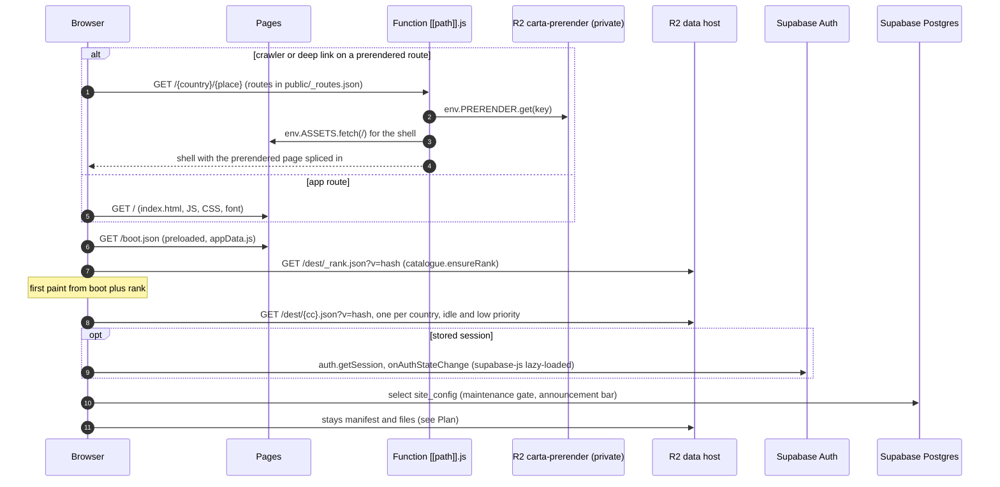
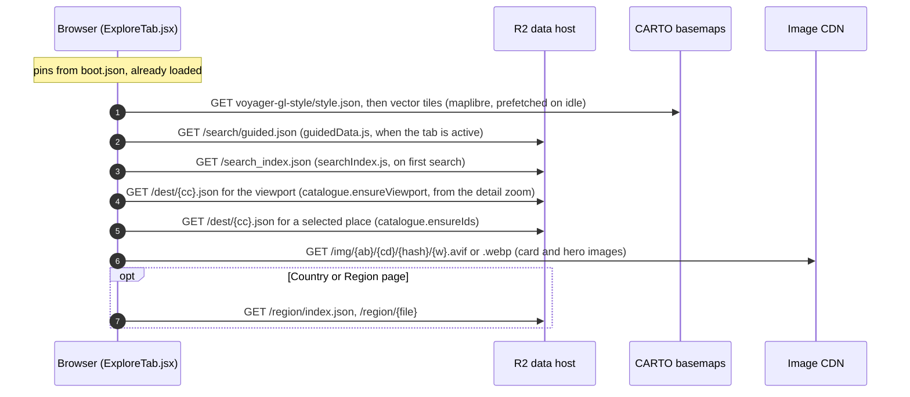
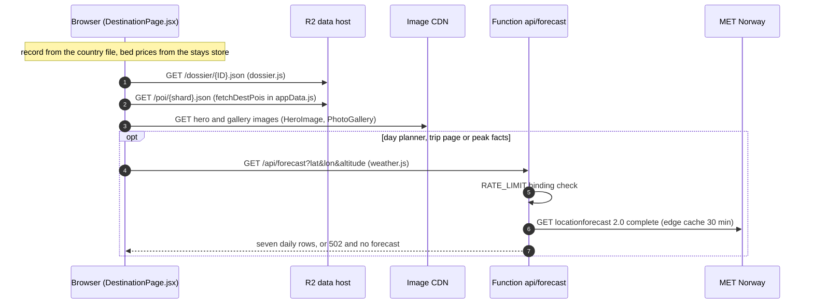
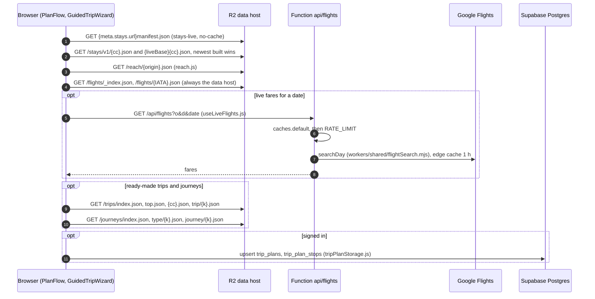
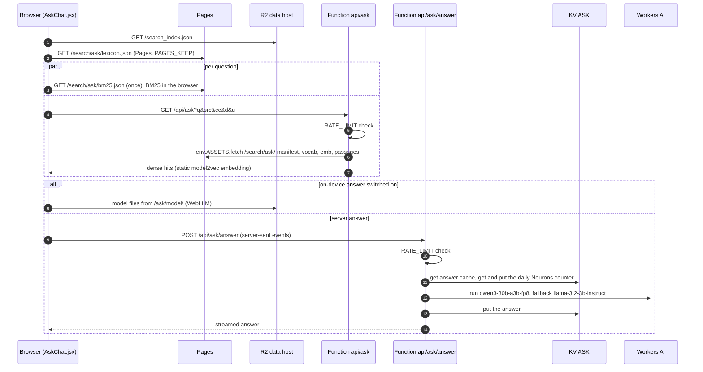
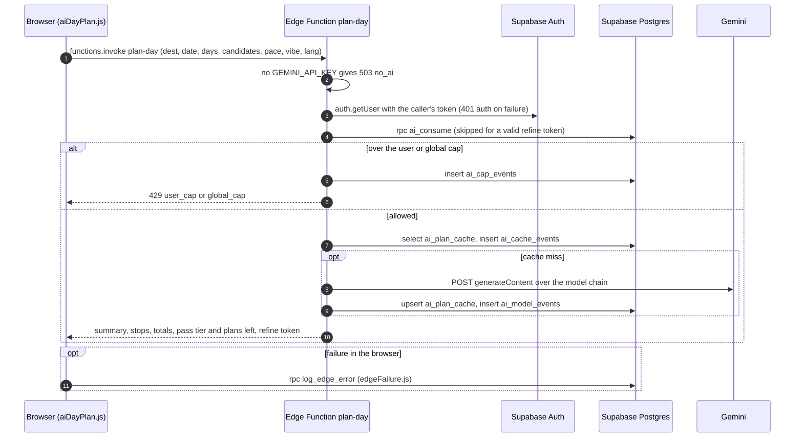
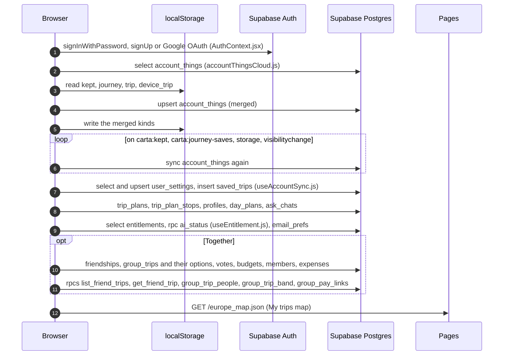

# Request paths

What the traveller's browser fetches, from where, on the seven paths that matter: first load, Explore, place page, Plan, Ask, plan-day and account sync. Written by T1166 (ROADMAP B5) from the code on 2026-11-06; file references are `continent-app/` paths unless they start with `supabase/`. The field by field lineage of what these files hold is in [lineage.md](lineage.md); the parts themselves are in [README.md](README.md). `scripts/docs/build_lineage.py --check` fails when a path heading below loses its diagram or a file named in backticks stops existing.

Hosts:

- **Pages**: the app host, same origin (Cloudflare Pages, project `carta-app`).
- **R2**: the data host, `data.carta-europetravel.com`. A path goes there only when it is in `R2_TIER` (`continent-app/src/lib/dataHost.js`) and the build sets `VITE_DATA_BASE`; until the owner cuts over, the same path is served by Pages. `search/ask` stays on Pages either way (`PAGES_KEEP`).
- **Function**: a Pages Function under `continent-app/functions/`.
- **Supabase**: Postgres through supabase-js (`.from()`, `.rpc()`), Auth, and Edge Functions under `supabase/functions/`.
- **CDN**: images on `cdn.carta-europetravel.com` (`continent-app/src/lib/imageLadder.js`); map style and tiles from CARTO basemaps.

Not found anywhere in the app: a Supabase realtime subscription, a fetch of `joins.json`, a screen that calls the `destinfo/` loader (`continent-app/src/lib/destInfo.js`).

## First load

The shell and the boot index come from Pages; the boot index preloads from `index.html`. The rank tier lets the first screen rank every place before any country file lands; the country files follow at low priority when the browser is idle (`continent-app/src/hooks/useAppData.js`). Auth is lazy: a guest with no stored session paints without waiting for Supabase (`continent-app/src/auth/AuthContext.jsx`). A crawler or a deep link to a place path goes through the catch-all Function `continent-app/functions/[[path]].js`, which splices a prerendered page from the private R2 bucket into the shell.

## Explore

Pins come from the boot index already in memory. Country files load for the viewport and for a selected place; the search index and the guided search table load when the tab needs them. Region files belong to the Country and Region pages, not to the Explore tab (`continent-app/src/lib/regions.js`). `continent-app/src/hooks/useExploreCatalog.js` makes no request: it derives rows from the catalogue.

## Place page

`continent-app/src/browse/DestinationPage.jsx` fetches two files: the dossier and the POI shard. Bed prices come from the stays store filled at boot, and photos from the image CDN. The forecast Function is called by trip and day planner widgets, not by the place page; it is drawn here because it is the one live call a place's weather makes.

## Plan

The planner reads more than any other path. Travel times come from the reach table of the chosen origin. Bed prices come from two copies, the baked `stays/` and the monthly `stays-live/`, and the newer `built` wins (`continent-app/src/lib/staysData.js`). Swept fares always come from the data host, even before the cut-over (`continent-app/src/lib/flights/flightData.js`). Live fares go through `continent-app/functions/api/flights.js`. Ready-made trips and journeys load on demand. A signed-in traveller's plan is saved to Supabase.

## Ask

Retrieval runs twice in parallel: BM25 in the browser and a dense search in `continent-app/functions/api/ask.js`, which embeds the question with a static model and reads its index from the deploy's own assets (no KV and no AI call). The written answer streams from `continent-app/functions/api/ask/answer.js` on Workers AI, behind a KV answer cache and a daily Neurons counter. If the traveller turned it on, an on-device model answers instead. A cap or a failure leaves the facts-only answer; retrieval works on BM25 alone when the dense call fails.

## plan-day

`continent-app/src/planner/aiDayPlan.js` invokes the Edge Function with the traveller's token. The function checks the key and the user, takes a pass quota through the `ai_consume` rpc, answers from `ai_plan_cache` when it can, and otherwise calls Gemini over its model chain. Never the Claude API (CLAUDE.md).

## Account sync

Local storage stays the source for a guest. On sign-in the sync modules load lazily, merge the local kinds (kept, journey, trip, device trip) with `account_things`, and write back; they sync again on the app's save events, on `storage` and on `visibilitychange` (`continent-app/src/auth/accountSync.js`). Settings, saved trips, plans, day plans, Ask history and the Together tables are plain reads and writes; there is no realtime subscription.

