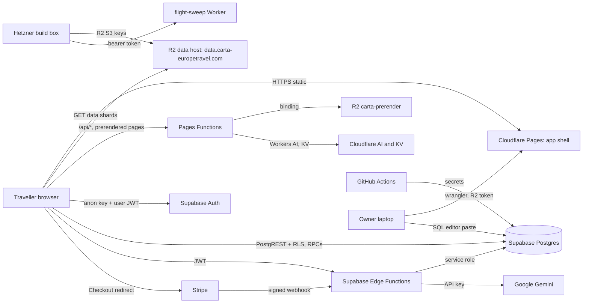

# Carta threat model

What can go wrong on each surface Carta runs, what stops it today, which test proves that, and what is still open. Built by T1069 (ROADMAP C1) on 2026-11-05 from the code in this repo. Every control below cites the file that holds it; every test cites the workflow or script that runs it. Where a claim could only be checked in a Dashboard (Supabase, Cloudflare, Stripe, GitHub settings), it says "not verified": this task read no Dashboard and touched nothing live.

Method: STRIDE per surface (Spoofing, Tampering, Repudiation, Information disclosure, Denial of service, Elevation of privilege), with likelihood and impact each rated Low, Medium or High for a one-person product with a public site and few accounts. Secrets are named, never valued; the secret inventory is `docs/security/SECRETS.md` (C2).

Keep it true: revisit this file whenever a surface is added or changes shape (ROADMAP C1; for example F5 and F7 add services). A task that closes a gap below updates its row and the ranked table.

## The whole system

Trust boundaries crossed by every request: the public internet to Cloudflare's edge, the browser to Supabase (the anon key is public; only the user's JWT and the row policies separate one account from another), Supabase to third parties (Stripe, Google, Resend) and the owner's machines to every control plane.

## 1. Static app on Cloudflare Pages

**Data flow.** `npm run build:pages` on the owner's laptop builds `continent-app/dist/`; `wrangler pages deploy` uploads it; Cloudflare serves it with the rules in `continent-app/public/_headers`.

**Assets.** The integrity of the JavaScript every traveller runs (it holds the Supabase session); the domain's reputation.

**Trust boundaries.** Owner laptop to Cloudflare (deploy token); edge to browser.

| STRIDE | Threat | L | I | Current control | Test |
|---|---|---|---|---|---|
| T | A malicious or compromised dependency ships in the bundle and reads the session from `localStorage` | M | H | `package-lock.json`; no automated audit | none yet (C6) |
| T | Someone with the Cloudflare token deploys a changed bundle | L | H | Token only on the owner's machine and the box (`SECRETS.md`) | none yet |
| I | XSS through injected markup, exfiltrating the session | L | H | CSP in `public/_headers` (`script-src 'self' 'wasm-unsafe-eval'`, `object-src 'none'`, `frame-ancestors 'none'`); React escaping | `continent-app/scripts/verify_csp.mjs` (manual run, not in CI) |
| I | A service key leaks into the bundle | L | H | Only `VITE_SUPABASE_ANON_KEY` is read by the app | `.github/workflows/secret-scan.yml` scans the built bundle |
| T | Clickjacking of account actions | L | M | `X-Frame-Options: DENY`, `frame-ancestors 'none'` | `verify_csp.mjs` (manual) |
| S | Downgrade to HTTP | L | M | HSTS two years with preload, `upgrade-insecure-requests` | `continent-app/tests/securityHeaders.test.mjs` (T1079) |

**Gap.** `style-src 'unsafe-inline'` stays in the CSP (React style attributes and MapLibre need it); no dependency audit (C6). Closed by T1079: the header test now runs in `npm test` and pins the headers, the script-src, the HSTS length and every wildcard host; `wss://*.supabase.co` left connect-src (nothing opens a socket); Permissions-Policy denies every unused feature; COOP is `same-origin-allow-popups`. Still open: the Wikimedia and Geograph image hosts (row T052-f), `verify_csp.mjs` is still a manual run.

## 2. Pages Functions (`continent-app/functions/`)

**Data flow.** `public/_routes.json` sends the country paths, `/trips/*`, `/journeys/*`, the share cards, the sitemaps and `/api/*` to Functions. `[[path]].js` reads prerendered HTML from the private R2 bucket `carta-prerender` (binding `PRERENDER`). `api/flights.js` runs the vendored fli client against Google Flights; `api/stays.js` proxies Xotelo; `api/forecast.js` proxies a weather source; `api/ask.js` and `api/ask/answer.js` answer Ask Carta with Workers AI (binding `AI`) and a KV counter (binding `ASK`).

**Assets.** Cloudflare request and Workers AI allowance (cost); the prerendered pages; the reputation of the outbound IPs (scraping).

**Trust boundaries.** Anonymous internet to the Function; the Function to third-party sites.

| STRIDE | Threat | L | I | Current control | Test |
|---|---|---|---|---|---|
| D | A script floods `/api/ask/answer` and spends the Workers AI allowance | M | M | Daily Neurons cap in KV (`CAP`, 429 `cap`) and a per-IP rate limit (`createLimiter` and `overLimit` in `functions/_lib/guard.js`, T1079) | `continent-app/tests/functionGuards.test.mjs`; no load test |
| D | The per-IP limit is per isolate (an in-memory window), so it does not hold across Cloudflare's edge | H | L | The daily KV cap is the real ceiling; T1079 added a guarded path to a Workers Rate Limiting binding `RATE_LIMIT` that is shared across the location (owner step) | `functionGuards.test.mjs` tests the binding path with a stub; the binding itself is not live |
| D | `/api/flights` and `/api/stays` used as a free proxy, getting the edge IPs blocked upstream | M | M | Edge cache (`caches.default`) on each answer; T1079: 20 live searches a minute per address on a cache miss, strict IATA and real-date checks | `functionGuards.test.mjs` |
| T | Path traversal into the prerender bucket | L | L | Keys are built by `prerenderKey()` in `src/lib/prerenderShell.js`; the bucket has no public domain | not verified by a test |
| I | A prerendered page served without the CSP | L | M | `[[path]].js` refuses to serve a shell without a `Content-Security-Policy` | not verified by a test |

**Gap.** Closed by T1079: every `/api/*` query string goes through a strict validator in `functions/_lib/guard.js` (lat and lon as plain decimals, real calendar dates, bounded Ask lists), every route answers 405 to other methods, every refusal is `{"error": code}`. Still open: the durable limit needs the `RATE_LIMIT` binding (`Execution/P15/_OPEN-web-hardening.md`); no test of the CSP refusal in `[[path]].js`.

## 3. R2 data host

**Data flow.** The pipeline writes data shards; `continent-app/scripts/r2/push-data.mjs` uploads them with the R2 S3 keys (`RCLONE_CONFIG_R2_*`); travellers read them over `data.carta-europetravel.com` with the CORS rules in `scripts/r2/data-cors.json` (GET and HEAD from the Carta origins only).

**Assets.** Integrity of every price, score and place the app shows; the bucket's egress.

**Trust boundaries.** Owner laptop and Hetzner box (write) to R2; R2 to the anonymous internet (read).

| STRIDE | Threat | L | I | Current control | Test |
|---|---|---|---|---|---|
| T | Someone with an R2 write key replaces or deletes the shipped data | M | H | Keys only in env files; `--prune` is a separate explicit step | none yet |
| T | The leaked `carta-r2-admin` token (2026-10-02, T291-b) is used | M | H | None until the owner rolls it | `Execution/P15/_OPEN-secrets-rotation.md` (owner) |
| I | Data meant to be private is pushed to the public bucket | L | M | The bucket only holds the public wire; no account data is written by the pipeline | not verified by a test |
| D | Hotlinking or egress abuse | L | L | CORS limits browsers to the Carta origins; R2 egress is free | n/a |

**Gap.** The leaked token is the single largest live risk on the data side (C2, owner step). No integrity check of the shards the app reads beyond the hash in the file name (`scripts/r2/verify` exists as `npm run data:verify`, run by hand).

## 4. Supabase Auth

**Data flow.** The browser signs up and signs in with email and password or magic link through `supabase-js` (`continent-app/src/auth/AuthContext.jsx`); Supabase issues an access JWT (claim `aal` = `aal1`, or `aal2` after a TOTP challenge) and a refresh token.

**Assets.** Account takeover; the owner's admin account above all.

**Trust boundaries.** Browser to Supabase Auth; the Dashboard settings decide most of the posture.

| STRIDE | Threat | L | I | Current control | Test |
|---|---|---|---|---|---|
| S | Credential stuffing or weak passwords | M | M | Dashboard settings: not verified. The local `supabase/config.toml` holds the defaults: `minimum_password_length = 6`, `password_requirements = ""`, `enable_confirmations = false` | none yet |
| S | Sign-up with someone else's email (no confirmation) | M | L | not verified on live | none yet |
| S | A stolen admin session acts as the admin | L | H | `admin_guard` requires `aal2` for every admin RPC (062, T1071; before it, delete, ban and set tier only) | `admin-rpc-security.yml` section 13: every callable admin function refuses an `aal1` admin and a token with no `aal` claim |
| R | No record of sign-ins | L | M | Supabase auth logs (Dashboard, retention per plan): not verified | n/a |
| D | Brute force of sign-in or OTP | M | M | Supabase auth rate limits; live values not verified (local defaults: 30 sign-ins per 5 minutes per IP) | none yet |
| E | Refresh token replay | L | M | Rotation on with a 10 second reuse window in `config.toml`; live value not verified | none yet |

**Gap.** Every auth setting that matters lives in the Dashboard and none was verifiable here: email confirmation, password length and classes, leaked-password check, rate limits, JWT expiry, refresh rotation, MFA enrolment for the owner. This is ROADMAP C3; T1071 lists the owner steps with values in `Execution/P15/_OPEN-auth-settings.md` (T1071-a). No CAPTCHA on sign-up (T1071-c).

## 5. Supabase database and row level security

**Data flow.** The browser reads and writes its own tables through PostgREST with the anon key and the user JWT; row policies decide each row. Definer functions (`security definer`, `set search_path = ''`) carry the cross-row work: reports, exports, admin RPCs. Base schema `supabase/schema.sql`, then `supabase/migrations/002` to `060`, pasted by hand by the owner.

**Assets.** Every traveller's trips, day plans, friends, group trips, expenses, emails; entitlements (paid passes).

**Trust boundaries.** `anon` and `authenticated` roles against the tables; definer functions against their callers.

| STRIDE | Threat | L | I | Current control | Test |
|---|---|---|---|---|---|
| I | A second traveller reads another traveller's rows | M | H | RLS on every table, owner predicates | `.github/workflows/rls-policies.yml` (`continent-app/scripts/admin/test_rls_policies.mjs`) |
| T | A traveller forges a row in another's name, or grants themself a pass | M | H | No client write policy on `entitlements`, `pass_grants`; insert checks `auth.uid() = user_id` | same workflow, the `forge` probes |
| E | A definer function with an unpinned `search_path` is hijacked | L | H | Every admin function pins it | `.github/workflows/admin-rpc-security.yml` asserts it for `admin_*`; other definer functions not checked |
| I | A policy calls a function the caller cannot execute (fails open or 42501) | M | L | `KNOWN_UNCALLABLE` tripwire in the RLS test | same workflow |
| T | A migration pasted out of order or a down file pasted by mistake | M | M | Each migration's self-check `do` block; owner procedures | none in CI beyond applying the stack |

**Verified state on 2026-11-05 (local Postgres 18, this task).** Both security workflows were red before this batch for a reason unrelated to policies: their loaders applied every `NNN_*.sql`, so from 055 on each `_down.sql` ran straight after its migration, and 056 then failed on `user_settings`, which only `supabase/schema.sql` creates. With the loaders corrected (skip `_down`, apply `schema.sql` first; the fix is committed by T1070), the admin surface passes 211 of 211 and the row policy suite passes 413 of 415. The two failures are real coverage debt: 19 tables from `schema.sql` and 052 to 060 have no isolation fixture (`ask_chats`, `email_log`, `email_prefs`, `friend_visibility`, seven `group_trip_*`, `pay_links`, `saved_trips`, four `shared_list*`, `trip_join_requests`, `user_settings`), and 28 policies on the group and shared-list tables call `group_role`, `group_all_joined` or `shared_list_role`, which `anon` cannot execute, so a signed-out read answers 42501 instead of an empty set. Neither is a leak (the refusals are refusals); both are unproven isolation.

**Gap.** Isolation is unproven for 17 of the 19 tables above (C4; T1070 wrote fixtures for `saved_trips` and `user_settings` and lists the other 17 as known entries, T1070-c), and the 28 uncallable policies are T1070-d. Definer functions outside `admin_*` are not checked for a pinned `search_path` by any test (C4). The upload tables and bucket (061, T1070) are covered by the row policy suite, Storage policies included.

## 6. Supabase Edge Functions (`supabase/functions/`)

**Data flow.** `plan-day`, `suggest-city` and `parse-booking` take the user JWT, check it with `auth.getUser()`, spend AI quota through `_shared/passes.mjs` (`consume`, `refund` RPCs) and call Gemini with `GEMINI_API_KEY`. `checkout` and `billing` take the user JWT and call Stripe with `STRIPE_SECRET_KEY`. `stripe-webhook` (deployed `--no-verify-jwt`) checks the Stripe signature. `notify` (deployed `--no-verify-jwt`) takes the cron call with `x-notify-secret` and the unsubscribe link with an HMAC token. All use `SUPABASE_SERVICE_ROLE_KEY` for their writes.

**Assets.** The Gemini bill; the service role key (bypasses every policy); user content sent to Google (`parse-booking` fetches a booking URL).

**Trust boundaries.** Browser to function (JWT); function to Postgres as service role; function to Google and Stripe; `parse-booking` to arbitrary URLs.

| STRIDE | Threat | L | I | Current control | Test |
|---|---|---|---|---|---|
| S | An unauthenticated caller spends AI quota | M | M | `auth.getUser()` before any spend in `plan-day/index.ts`, `suggest-city/index.ts`, `parse-booking/index.ts` | none in CI against a deployed function |
| D | A signed-in account burns the Gemini budget | M | M | Per-tier quota in Postgres (`plan_tiers`, `ai_consume`, 007, 044) | quota RPCs exercised by `test_admin_rpc_security.mjs` indirectly; no function test |
| E | Prompt injection makes the model output something the app trusts | M | M | JSON response schema in `plan-day`; output sanitising in `suggest-city/logic.mjs` | unit tests of `logic.mjs` in `continent-app/tests/`; no injection set (C8) |
| I | SSRF through `parse-booking` fetching an internal URL | L | M | `safeFetchUrl()` in `parse-booking/logic.mjs` refuses private and loopback hosts by name; a public name that resolves to a private address (DNS rebinding) is not checked | unit tests in `continent-app/tests/` |
| S | A forged cron call to `notify` | L | M | `x-notify-secret` compared in constant time with `secretMatches` (T1079) | `continent-app/tests/notify.test.mjs` (unsubscribe token only) |
| I | Error bodies leak internals | L | L | Functions answer coded errors (`{ code }`); T1079 removed the Stripe and database messages that two functions echoed, and `withCors` turns an escaped exception into a fixed 500 | `continent-app/tests/edgeHttp.test.mjs` (static contract over every function) |
| T | CORS `Access-Control-Allow-Origin: *` on every function | L | L | Auth is a bearer header, not a cookie, so a cross-site page cannot ride the session; T1079 answers only the app origins (production, Pages previews, localhost) through `withCors` | `edgeHttp.test.mjs` |

**Gap.** No end-to-end test of any deployed function's refusal paths; no injection set (C8). Closed by T1079: the CORS allow-list, the notify secret compare, the 413 body caps (4 KB to 9 MB per function) and generic error bodies. The upload path needs a server-side privacy pass (T1070).

## 7. Stripe

**Data flow.** `checkout` creates a Checkout session; the traveller pays on Stripe; Stripe posts `checkout.session.completed`, `invoice.paid` and subscription events to `stripe-webhook`, which verifies them with `stripe.webhooks.constructEventAsync(raw, sig, STRIPE_WEBHOOK_SECRET)` and writes `pass_grants` and `entitlements` through idempotent RPCs (007, 053).

**Assets.** Passes (paid access); revenue; card data never touches Carta.

**Trust boundaries.** Stripe to the webhook endpoint (public URL); Stripe Dashboard (owner).

| STRIDE | Threat | L | I | Current control | Test |
|---|---|---|---|---|---|
| S | A forged webhook grants a pass | M | H | Signature check before any parse (`stripe-webhook/index.ts`, `constructEventAsync` on the raw body); T1079 verified it and made the failure bodies generic | `edgeHttp.test.mjs` pins the order (raw body, signature, then any database call) |
| T | A replayed event grants twice | L | M | Grants are idempotent on the session id and the invoice id (the session ledger of migration 007) | `edgeHttp.test.mjs` pins the `p_session_id` key; the replay itself is a database behaviour (RLS fixtures, C4) |
| R | A disputed payment with no trail | L | M | Stripe holds the record; `pass_grants` keeps the session id | n/a |
| I | Live keys leak | L | H | Test mode today; `secret-scan.yml` blocks the key shapes | `secret-scan.yml` |

**Gap.** T1079 checked the code path statically; no test sends a wrongly signed body to a running webhook (needs Deno and the Stripe library, so it belongs in the C10 pass against a preview).

## 8. The upload path (T333, server half T1070)

**Data flow.** The trail page form (`continent-app/src/community/UploadForm.jsx`) strips a photo's metadata or trims a track's ends on the device (`src/lib/stripImageMeta.js`, `src/lib/gpxPrivacy.js`), then `submitUpload` in `src/community/uploads.js` calls `begin_upload`, uploads into the private bucket `user-uploads` at the path it was given, and calls `finish_upload`. Every 15 minutes `supabase/functions/upload-scan` sweeps, deletes queued files through the Storage API and re-runs the privacy pass on pending uploads. An admin publishes, declines or removes with `admin_decide_upload`. All of it is in `supabase/migrations/061_user_uploads.sql`, written by T1070 and not yet applied live (`Execution/P15/_OPEN-uploads.md`).

**Assets.** The uploader's location and identity (home address at a track's ends, EXIF GPS); third parties in a photo; Carta's liability for what it publishes; storage cost.

**Trust boundaries.** Browser to Storage API (anyone with a session can call it directly, so the device pass is advisory); bucket to the public (only published uploads are readable, through signed URLs); the Edge Function as service role.

| STRIDE | Threat | L | I | Current control (061 unless named) | Test |
|---|---|---|---|---|---|
| I | A caller skips the device pass and stores a photo with GPS, or a full track | H once live | H | `upload-scan` re-runs both modules on every pending upload (copies in `supabase/functions/_shared`); `admin_decide_upload` answers `not_scanned` for an upload the pass has not cleared | `continent-app/tests/uploadScan.test.mjs`; `test_admin_rpc_security.mjs` section 12 |
| T | A caller writes into another account's folder or overwrites a file | M | M | Storage insert policy: own folder only, only at the path of one of their own reserved rows; no update or delete policy | `test_rls_policies.mjs` section 4e |
| I | A pending or declined upload is read by a stranger | M | M | Bucket private; read for the owner and an admin, and for anyone only when the row is published (`upload_is_published`) | `test_rls_policies.mjs` section 4e |
| D | Storage filled by one account | M | L | 20 reservations a day per account and 2,000 overall under an advisory lock; 25 MB bucket limit, 10 MB for a track; reserved rows without a file swept after a day | `test_rls_policies.mjs` section 4e |
| R | A takedown with no reasons | L | M | A decline or removal needs a ground and a statement of reasons; contest date six months; one audit row per decision | `test_admin_rpc_security.mjs` section 12 |
| I | Files outlive the account | M | M | A trigger on `auth.users` queues the `{uid}/` folder; the row trigger queues each file; `upload-scan` deletes them through the Storage API | `test_rls_policies.mjs` section 4e |
| S | A forged cron call to `upload-scan` | L | L | `x-uploads-secret` compared in constant time (`secretOk` in `upload-scan/logic.mjs`); the function only sweeps and scans, it publishes nothing | `uploadScan.test.mjs` |

**Gap.** Applying 061 and deploying `upload-scan` are owner steps (T1070-a). The Storage stubs the tests use mirror only the columns the policies read; the policies have not run against the real Storage API (not verified). The app half (published uploads on the page, the review list) is T333-c; the legal wording is T333-b.

## 9. Hetzner build box and its scrapers

**Data flow.** `infra/hetzner/cax11/cloud-init.yaml` provisions the box; systemd timers in `infra/hetzner/cron/` run the weekly pipeline, the stays scrape and the late flight sweep; results go to R2 (S3 keys) and to the flight-sweep Worker (`INGEST_TOKEN`, compared in constant time by `tokenOk()` in `workers/flight-sweep/src/ingest.mjs`).

**Assets.** The `.env` on the box holds the widest set of critical secrets (`SUPABASE_DB_URL`, `CARTA_BACKUP_KEY`, `CLOUDFLARE_API_TOKEN`, `HCLOUD_TOKEN`, R2 keys); the data it publishes.

**Trust boundaries.** Internet to SSH; box to every control plane; scraped sites to the parser.

| STRIDE | Threat | L | I | Current control | Test |
|---|---|---|---|---|---|
| S | SSH brute force | L | H | Key only, `PermitRootLogin no`, `PasswordAuthentication no`, ufw on (`cloud-init.yaml`) | `infra/hetzner/cax11/verify.sh` (run by hand) |
| E | An unpatched package | M | H | `unattended-upgrades` on, no automatic reboot (a weekly reboot timer `carta-reboot.timer`) | `verify.sh` |
| T | A scraped page with crafted content poisons the data | M | M | Parsers keep numbers only; the price engine checks ranges (Prices handbook) | pipeline tests in `tests/` |
| I | The box is lost with every secret on it | L | H | Secrets in one `.env`; no secret manager | none yet (C2) |
| D | The scrapers get the box's IP blocked | M | L | Proxy env (`HTTPS_PROXY`), rate limits in the scrapers | n/a |

**Gap.** Many critical secrets on one host with no rotation record (C2); `verify.sh` is not scheduled.

## 10. GitHub and CI

**Data flow.** Pushes and pull requests run `.github/workflows/ci.yml` and twelve path-triggered workflows; `uptime.yml` runs on a schedule with `CARTA_SUPABASE_SERVICE_KEY`; `golden-set.yml` uses `GEMINI_API_KEY`.

**Assets.** The repository (it carries the migrations the owner pastes); the workflow secrets.

**Trust boundaries.** Third-party actions running with the repo's token and secrets.

| STRIDE | Threat | L | I | Current control | Test |
|---|---|---|---|---|---|
| T | A tag-pinned action (`actions/checkout@v4` in 13 places, `setup-node@v4` in 5, `setup-python@v5` in 7, `upload-artifact@v4` in 2) is moved to malicious code | L | H | Four uses are SHA-pinned; the other 27 are tags | none yet (C6) |
| I | A workflow prints a secret | L | H | GitHub masks secrets; `uptime.yml` says "never printed" | `secret-scan.yml` on the tree |
| E | The uptime job holds the service role key when the anon key may do | M | H | none | none yet (C2 row) |
| T | A pull request from a fork reads secrets | L | H | `pull_request` (not `pull_request_target`) everywhere; only three workflows set `permissions` | not verified for repo settings |
| T | Branch protection on `main` | n/a | H | not verified (GitHub settings) | n/a |

**Gap.** Actions not pinned to SHAs, no Dependabot or Renovate (C6); no SAST (C7); default token permissions on ten workflows.

## 11. Admin surfaces

**Data flow.** `continent-app/src/admin/AdminPage.jsx` behind a re-auth lock (`AdminLock.jsx`, a second pair of eyes, not a gate) and, since T1071, a TOTP step-up (`MfaStepUp`) before anything loads; every action is an `admin_*` RPC that calls `public.admin_guard()` (membership in `admin_users`, then `aal2` since 062, then a rate budget counted on `admin_audit_log`, 015, 051) and writes `admin_audit_log` through `public.admin_log()` when it changes something. The owner also pastes SQL in the Supabase SQL editor.

**Assets.** Every account (ban, delete, tier), the site's live config, the moderation decisions, every email address.

**Trust boundaries.** Admin browser session to the admin RPCs; the Supabase Dashboard (outside the app entirely).

| STRIDE | Threat | L | I | Current control | Test |
|---|---|---|---|---|---|
| E | A normal account calls an admin RPC | M | H | `admin_guard()` first in every function; `anon` has no grant | `admin-rpc-security.yml`, discovered from `pg_proc`, 211 assertions |
| S | A stolen `aal1` admin session reads every account and changes config | L | H | `aal2` required by `admin_guard` for every tier (062); the admin storage read needs `aal2` too | `admin-rpc-security.yml` section 13 |
| R | An admin action with no reason on record | M | M | `admin_audit_log` has `target` and `reason` (062), filled from the detail by a trigger; every VOLATILE admin RPC writes a row (`admin_set_infra_cost` since 062). Ban, delete and set tier take no reason argument (T1071-b) | `admin-rpc-security.yml` section 13 (static and dynamic) |
| D | A scripted admin floods writes | L | M | Rate budget in `admin_guard` (60 a minute, 10 destructive, 20 live) | `admin-rpc-security.yml` section 7 |
| E | SQL pasted in the Dashboard with a typo or the wrong file | M | H | Self-check blocks in each migration; owner procedures | none |

**Gap.** 062 is written, not applied (T1071-a; the owner enrols TOTP first). A refusal at the guard leaves no audit row (the guard is STABLE); admin reads are not logged by design (the rate budget counts rows). Ban, delete and set tier record no reason (T1071-b). The Supabase Dashboard account itself is the stronger admin surface and needs MFA (C2 owner step).

## Top gaps, ranked

Ranked by likelihood times impact, then by how cheaply the next step closes it.

| Rank | Gap | Surface | L | I | ROADMAP item | Next step |
|---|---|---|---|---|---|---|
| 1 | Leaked `carta-r2-admin` token not rolled | R2, Pages | M | H | C2 | Owner rolls it (`_OPEN-secrets-rotation.md`) |
| 2 | Auth Dashboard settings unverified (confirmation, password rules, leaked-password check, rate limits, owner MFA) | Supabase Auth | M | H | C3 | Owner steps in `_OPEN-auth-settings.md` (T1071) |
| 3 | Admin reads and live writes accept an `aal1` session | Admin | L | H | C3 | 062 written and tested (T1071); owner enrols TOTP and applies (T1071-a) |
| 4 | 19 tables without an isolation fixture; 28 policies uncallable by `anon` | Database | M | H | C4 | Fixtures per table; grant or role-scope the helper functions |
| 5 | Upload path server half written but not applied (061, `upload-scan`) | Uploads | H once live | H | T333-a (C4) | Owner applies (`_OPEN-uploads.md`, T1070-a) |
| 6 | Dependency audit, SHA-pinned actions, Dependabot | CI, app | M | H | C6 | Add `npm audit`, `pip-audit`, OSV and pins |
| 7 | Stripe webhook signature check has no test | Stripe | M | H | C5 | Static order test done (T1079); a live wrong-signature probe goes to C10 |
| 8 | Uptime job holds the service role key | GitHub | M | H | C2 | Switch to the anon key if the probe allows |
| 9 | No durable rate limit on `/api/*` and Edge Functions; CORS `*` | Pages Functions, Edge | M | M | C5, H3 | Origin allow-list and body caps done (T1079); the shared limiter needs the `RATE_LIMIT` binding (owner), durable Edge Function limits are H3 |
| 10 | No prompt-injection set or guardrail module | Edge AI | M | M | C8, E3 | Injection set in CI |
| 11 | Ban, delete and set tier record no reason; guard refusals are not logged | Admin | M | L | C3 | A reason argument on the three RPCs and the app (T1071-b) |
| 12 | No CSP or security-header test in CI; `style-src 'unsafe-inline'` | Pages | L | H | C5 | Header test in `npm test` done (T1079); `verify_csp.mjs` still manual |
| 13 | No SAST | CI | L | M | C7 | Semgrep or CodeQL |
| 14 | Critical secrets concentrated on the Hetzner box | Build box | L | H | C2 | Rotation record; narrower keys per job |
| 15 | No ZAP baseline, no ASVS walk | All | L | M | C10 | After C5 |
